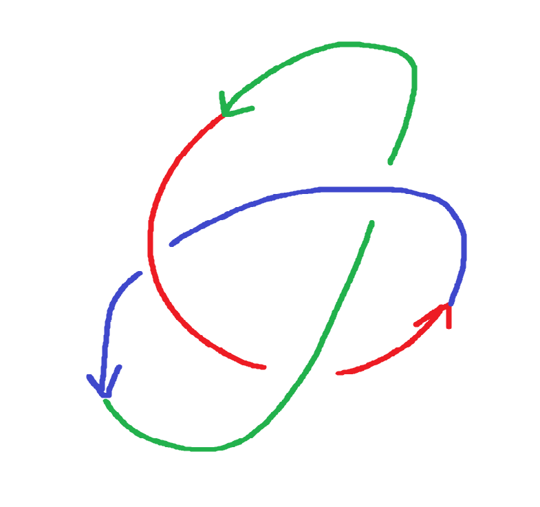

# Cybernetic-AI-Governor

<p align="center"></p>


[](https://arxiv.org)
[](https://gnu.org)

A Cybernetics inspired Governor Framework to maintain viability of AI models.
A cybernetic runtime architecture that introduces formal **systemic identity, homeostasis, and structural reconfiguration** to autonomous AI agents and multi-agent orchestration. 

By operationalising **W. Ross Ashby's Law of Requisite Variety** and **Gordon Pask's Conversation Theory**, this framework decouples parameter optimization (*learning to make*) from real-time dynamic regulation (*learning to use*), completely eliminating semantic drift and infinite execution loops without running expensive continuous backpropagation.

## 🧠 Core Theoretical Framework

*   **Spencer-Brown Distinction Gates:** Establishes a primary boundary splitting the system into "Self" (invariant values/constraints) and "Environment" (context window/inputs) to enforce a stable agentic identity.
*   **Ashby's Homeostatic Regulation:** Continuous runtime tracking of *essential variables* (\(E(t) \in \Omega\)). Environmental disturbances (adversarial inputs, drift) trigger immediate topological routing shifts to restore equilibrium.
*   **Paskian Conversation Mesh:** Replaces rigid, hardcoded multi-agent Directed Acyclic Graphs (DAGs) with dynamic, interactive agreement protocols (*Teachback loops*) to guarantee semantic synchronization across swarms.
*   **No Doppelgängers Theorem:** A formal proof demonstrating that an agent's identity and value trajectory are invariant, uncopyable functions of its unique historical interaction path.

## 🛠️ Repository Architecture (Coming Soon)

```text
├── src/
│   ├── governor/          # Main Autopoietic Governor loop
│   │   ├── distinction.py # Spencer-Brown boundary monitor
│   │   └── homeostat.py   # Ashby variable regulation & variety tracking
│   ├── orchestration/     # Paskian multi-agent conversation protocols
│   └── expert_pool/       # M-Actor frozen underlying models (CNN/LLM nodes)
├── experiments/           # Quantitative benchmark suites
│   ├── cnn_mnist_cifar/   # Robustness under distributional shifts
│   └── rl_cartpole/       # Restabilization under extreme perturbations
└── paper/                 # LaTeX preprint source files
```

## 📖 Citation

If you use this framework or the theoretical proofs in your research, please cite our preprint:

```bibtex
@article{day2026autopoietic,
  title={An Autopoietic Governor for Agentic AI: Operationalising Paskian Conversation Theory and Ashby's Requisite Variety for Resilient Machine Identity},
  author={Day, Matthew},
  journal={arXiv preprint arXiv:2610.XXXXX},
  year={2026}
}
```

## 📜 License & Commercial Use

This project is licensed under the **GNU General Public License v3.0 (GPL-3.0)**. 

**Commercial Licensing Notice:** The copyleft nature of the GPL-3.0 requires any derivative works or proprietary enterprise platforms utilizing this framework to completely open-source their infrastructure. For enterprise teams requiring closed-source deployment, proprietary system integration, or architectural consulting, please contact the author directly for **commercial dual-licensing agreements**.
